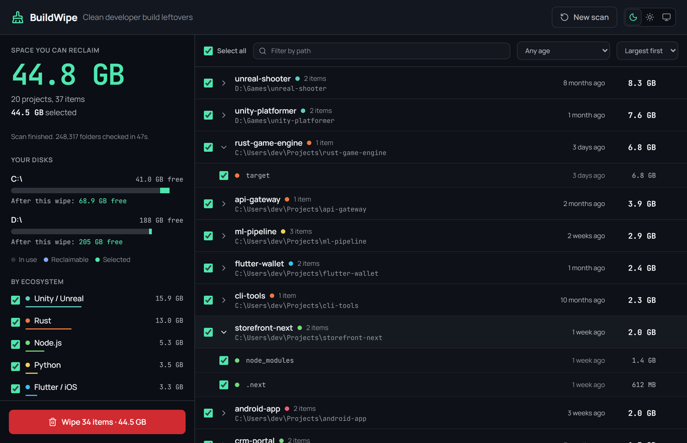
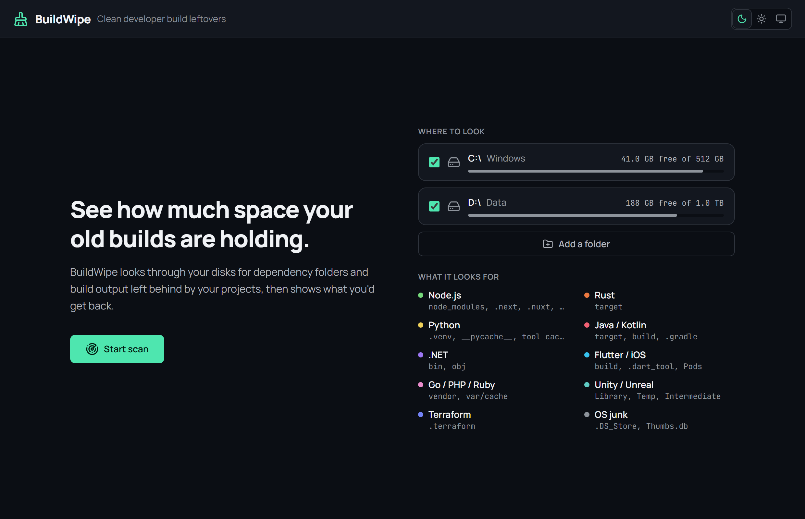
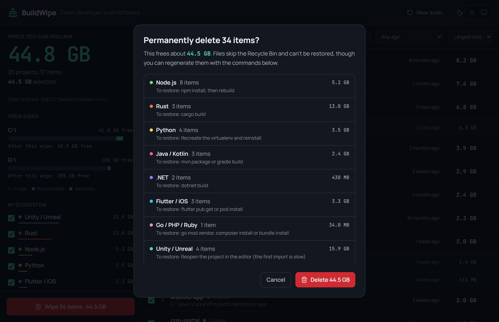
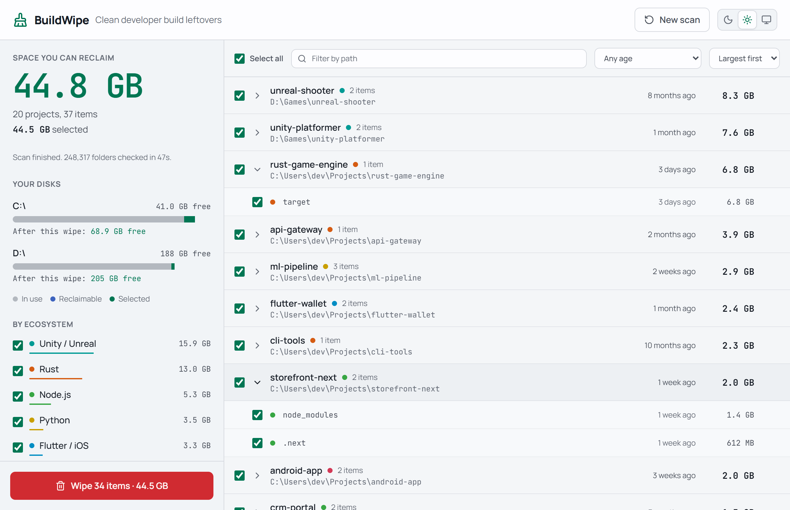

<p align="center">
  
</p>

<h1 align="center">BuildWipe</h1>

<p align="center">
  Find the gigabytes your old builds left behind, and get them back.
</p>

<p align="center">
  <a href="https://github.com/2001abhishek/BuildWipe/actions/workflows/ci.yml"></a>
  
  
  <a href="LICENSE"></a>
</p>

<p align="center">
  
</p>

Every project you've ever built leaves something behind: `node_modules`, Rust `target` folders, Python virtualenvs, Gradle caches, Unity `Library` folders. They're easy to regenerate and easy to forget, and together they can fill a disk.

BuildWipe scans your drives, finds those leftovers, and shows how much free space you'd have on each disk after removing them. Nothing is deleted until you tick it and confirm.

## Features

- **Scans whole disks,** or just the folders you choose, in parallel, with live progress.
- **Shows the payoff per disk:** free space now, and free space after the wipe, updated as you tick items.
- **Groups results by project,** with filters by ecosystem, age ("untouched for 6+ months") and path.
- **Plays it safe:** ambiguous folders only match next to the project file that explains them, and anything that might hold real work is flagged for review. See [How BuildWipe stays safe](#how-buildwipe-stays-safe).
- **Tells you how to restore:** the confirm dialog lists the command that regenerates each kind of folder.
- **Dark and light themes,** or follow the system setting.
- **Small and native:** about 5 MB, built on Tauri with a Rust backend.

## What it finds

| Ecosystem | Folders and files | Only when next to |
|---|---|---|
| Node.js, Next.js, Nuxt, Angular, SvelteKit | `node_modules`, `.next`, `.nuxt`, `.output`, `.angular`, `.svelte-kit`, `.turbo`, `.parcel-cache`, `dist` | `package.json` (or the framework's config) |
| Rust | `target` | `Cargo.toml` |
| Python | virtualenvs (any folder with `pyvenv.cfg`), `__pycache__`, `.pytest_cache`, `.mypy_cache`, `.ruff_cache`, `.tox` | |
| Java and Kotlin | `target`, `build`, `.gradle` | `pom.xml` or `build.gradle(.kts)` |
| .NET | `bin`, `obj` | a `.csproj`, `.fsproj` or `.vbproj` file |
| Flutter and iOS | `build`, `.dart_tool`, `Pods` | `pubspec.yaml` or `Podfile` |
| Go, PHP and Ruby | `vendor`, `var/cache` | `go.mod`, `composer.json` or `Gemfile` |
| Unity and Unreal | `Library`, `Temp`, `Intermediate`, `DerivedDataCache` | Unity's `Assets` and `ProjectSettings`, or a `.uproject` file |
| Terraform | `.terraform` | a `.tf` file |
| OS junk | `.DS_Store`, `Thumbs.db` | |

## How BuildWipe stays safe

BuildWipe deletes permanently, so it's built to be cautious:

- **A name alone is never enough.** `target`, `build`, `bin` and `Library` are common folder names, so they only match next to the project file that proves which tool made them. A `docs/build` folder is left alone.
- **System and app folders are never scanned:** `C:\Windows`, Program Files and AppData on Windows; `/System`, `~/Library` and `.app` bundles on macOS; `/usr`, `/etc` and snaps on Linux. Package caches such as Go's module cache are also left alone, along with installed apps and hidden folders like `.cargo`.
- **Symlinks and junctions are never followed,** so a wipe can't reach outside the folder you selected.
- **Nothing is preselected.** "Select all" leaves out items flagged for review, such as `vendor` and `dist`, which are sometimes committed on purpose.
- **Only what the scan found can be deleted,** and each item is checked again on disk right before deletion. If a project changed since the scan, its items are skipped.

> [!WARNING]
> Deleted folders skip the Recycle Bin or Trash. They can be regenerated with each tool's install or build command, but anything you put inside them by hand is gone.

## Screenshots

| Choose where to look | Confirm before anything is deleted |
|---|---|
|  |  |

<p align="center">
  
</p>

## Install

Prebuilt installers aren't published as releases yet. Every push builds them for Windows (`.msi`, `.exe`), macOS (`.dmg`) and Linux (`.deb`, `.rpm`, `.AppImage`) in GitHub Actions. To get one, open the latest [CI run](https://github.com/2001abhishek/BuildWipe/actions/workflows/ci.yml), then download the **BuildWipe-*your OS*** artifact from the bottom of the page. You need to be signed in to GitHub to download artifacts.

- **macOS:** the app isn't signed yet, so macOS blocks it the first time. Right-click the app, choose **Open**, then confirm. To scan Desktop, Documents and Downloads fully, allow access when macOS asks, or grant Full Disk Access under System Settings › Privacy & Security.
- **Windows:** the app uses Microsoft Edge WebView2, which is already installed on Windows 10 and 11.

### Build from source

You need [Node.js](https://nodejs.org/) 22 or newer, [Rust](https://rustup.rs/), and Tauri's [system prerequisites](https://v2.tauri.app/start/prerequisites/) for your OS. On Ubuntu and Debian, those are:

```sh
sudo apt install libwebkit2gtk-4.1-dev libayatana-appindicator3-dev librsvg2-dev libxdo-dev libssl-dev build-essential
```

Then:

```sh
git clone https://github.com/2001abhishek/BuildWipe.git
cd BuildWipe
npm install
npm run tauri build
```

The installers are written to `src-tauri/target/release/bundle/`.

## Development

```sh
npm run tauri dev                                  # run the app with hot reload
cargo test --manifest-path src-tauri/Cargo.toml    # run the backend tests
```

| Path | What's there |
|---|---|
| `src/` | The React 19 interface, styled with Tailwind CSS v4. Colours and fonts are design tokens in `src/index.css`. |
| `src-tauri/src/rules.rs` | What counts as a build artifact. Add a new ecosystem here. |
| `src-tauri/src/platform/` | Everything that differs between Windows, macOS and Linux, one file per OS. |
| `src-tauri/src/scanner.rs` | The parallel disk scan. |
| `src-tauri/src/wipe.rs` | Deletion and the safety checks that run before it. |

Scans and wipes run on background threads in Rust and stream their results to the interface as they go.

## Contributing

Issues and pull requests are welcome. Because BuildWipe deletes files, any change to what gets matched or skipped needs a test, including a case for what must **not** match. Test deletion only against throwaway folders, never real projects.

## License

[MIT](LICENSE) © Abhishek Ray
